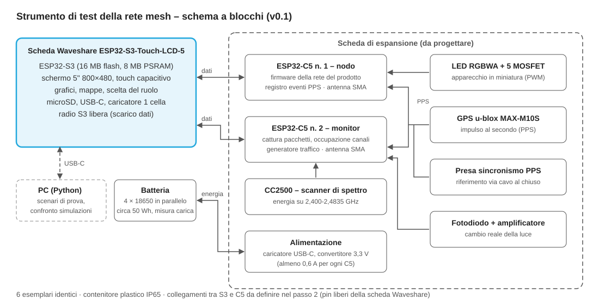

# DinamicMesh_tester

Strumento di test della rete mesh della [linea RGB architetturale wireless](https://github.com/lucaversus/DinamicMesh_wireless) di Versus Lux.

Un unico apparecchio a batteria, costruito in 6 esemplari identici, con schermo touch da 5 pollici. Ogni esemplare può fare da nodo della rete, coordinatore, monitor radio, generatore di traffico Wi-Fi o strumento di rilievo sul campo. Serve a tre cose:

1. provare il firmware della rete al banco;
2. tarare il [simulatore di coesistenza](https://github.com/lucaversus/DinamicMesh_wireless/tree/main/simulazioni) con misure reali;
3. fare il rilievo radio su facciate e ponti prima di vendere un impianto.

## Contenuto

| Cartella | Contenuto | Stato |
| --- | --- | --- |
| [`docs/specifica.md`](docs/specifica.md) | Specifica: ruoli, architettura, componenti, distinta, punti aperti | v0.1 (passo 1) |
| [`hardware/`](hardware/) | Schema elettrico della scheda di espansione, piedinatura, distinta definitiva | Passo 2, da fare |
| [`firmware/`](firmware/) | Firmware dei due ESP32-C5 (nodo e monitor) e dell'ESP32-S3 (interfaccia) | Passo 3, da fare |
| [`software-pc/`](software-pc/) | Software Python: scenari di prova, scarico registri, confronto con le simulazioni | Passo 4, da fare |

## Architettura in breve

- **ESP32-S3** (scheda Waveshare ESP32-S3-Touch-LCD-5): schermo, grafici, microSD, scelta del ruolo.
- **ESP32-C5 n. 1**: nodo sotto prova, con il firmware della rete del prodotto e PWM a 5 canali.
- **ESP32-C5 n. 2**: monitor (cattura pacchetti, occupazione canali, generatore di traffico).
- **CC2500**: scanner di spettro a 2,4 GHz.
- **GPS u-blox MAX-M10S** con impulso al secondo e presa di sincronismo via cavo.
- **LED RGBWA**, **fotodiodo**, **4 celle 18650**, contenitore IP65.

## Progetto collegato

[DinamicMesh_wireless](https://github.com/lucaversus/DinamicMesh_wireless): specifica della linea, ricerche di mercato, simulazioni e [registro delle decisioni](https://github.com/lucaversus/DinamicMesh_wireless/blob/main/docs/registro-decisioni.md).
